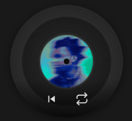

# RPM 🎵
#### (Record Player Majig)




a lil spinning vinyl disc that sits on your desktop and shows what you're listening to. that's it. that's the whole pitch. (for those who find opening spotify to pause/ play/ skip/ loop ain't that vibey. and using headphone controls are not *it*, you need a lil figety lil widget).

it's spinning, always on top, and tiny with your fav music's album cover — so it won't get in your way AND it's pretty cool.

---

## what it does

- spins when music is playing (duh)
- hover over it and it expands to show controls (loop or skip to beginning)
- click to pause, double-click to skip
- drag it anywhere on screen
- hides to the system tray when you close it

---

## getting it runninggg

### step 1 — install stuff

you'll need [Node.js](https://nodejs.org) installed. then:

```bash
npm install
```

### step 2 — run it

```bash
npm start
```

or if you don't want a terminal window hanging around, just double-click **`launch.vbs`** (it's the file named "launch" and has a vbs extension) and it'll start silently in the background like a cute lil stalker, playing music.

---

## controls

| do this | get this |
|---|---|
| click the disc | play / pause |
| double-click the disc | skip to next |
| drag the disc | move it wherever |
| hover over it | controls appear |
| click the tray icon | show / hide the widget |

---

## optional: Spotify like button

totally optional but cool — lets you save/unsave tracks right from the widget.

**getting your Client ID:**

1. go to [developer.spotify.com/dashboard](https://developer.spotify.com/dashboard) and log in with your Spotify account
2. click **Create app**, give it any name/description, and set the Redirect URI to `http://localhost:8888/callback`
3. once created, you'll see your **Client ID** on the app page — copy it
4. paste it into `config.json` in the project folder:

```json
{
  "spotifyClientId": "paste-your-id-here"
}
```

5. next time you launch the widget it'll ask you to log in once via browser, and you're good

no Client ID? no problem — the widget still works fine, it just won't have the like button.

---

## credits

big shoutout to [jeshu-collab](https://github.com/jeshu-collab/Spotify-widget) who made the original. this fork cleans up the hitbox so clicks don't bleed outside the disc, adds the Spotify API stuff, and throws in the silent launcher.
